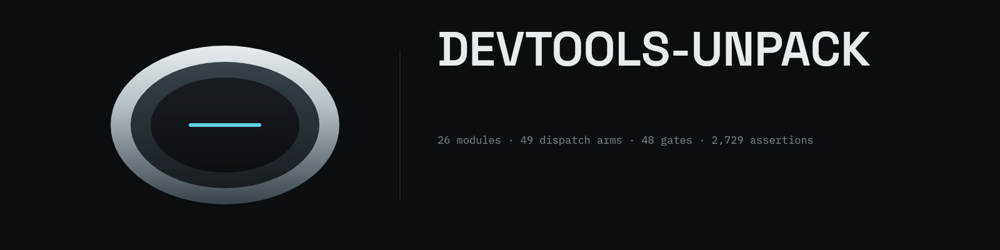

<p align="center">
  
</p>

# devtools-unpack — the Common Lisp engine

An unpack engine in SBCL Common Lisp: capture everything a web page loads and
runs, then peel every obfuscation layer off it — base64, hex escapes, `eval`
wrappers, packers, JSFuck — and write one unpacked, site-aware archive.

This was previously a Rust engine compiled to WebAssembly, powering a Chrome
DevTools extension. The Rust tree and the extension were removed: the SBCL port
is the engine now, held to the same oracles the wasm build was held to. The
oracles are frozen fixtures — captured from the shipped wasm engine before the
tree was deleted — and the port's export is byte-identical to that engine's.

## Quick start

```bash
# the whole gate: 48 gates, 2,729 assertions, exit 0 when green
sbcl --script tools/cl/run-engine.lisp

# the native CLI
sbcl --script tools/cl/run.lisp engine           # list the 49 callable functions
sbcl --script tools/cl/run.lisp engine sha256Hex '["abc"]'
sbcl --script tools/cl/run.lisp unpack capture.json --out unpacked
```

First run pulls `cl-ppcre`, `jzon`, `ironclad`, `babel`, `chipz`, `salza2`,
`cl-unicode` through Quicklisp; after that it is instant.

## What is here

```
tools/cl/engine/             the engine port: 26 modules, every public function
                             gated against an oracle
tools/cl/engine/gate-*.lisp  the 48 gates
tools/cl/fixtures/oracles/   the frozen oracle fixtures (13 JSON oracles, the
                             binary blobs, the dispatch-surface record)
tools/cl/                    the SBCL toolchain: paths, subprocesses, JSON,
                             a WebSocket + HTTP client for the DevTools Protocol
agent/ledger.md              the engineering ledger: what failed, what fixed it
```

## The parity claim

`finalize parity` replays the shipped engine's whole answer — 53 artifacts — and
compares every file's bytes after normalising the clock. That is the strongest
assertion in the suite: not "the port is plausible" but "the port writes the
same bytes the engine wrote."

The dispatch surface (49 arms) is frozen in `tools/cl/fixtures/oracles/dispatch-arms.json`,
captured from `wasm_api.rs` the day the Rust tree was deleted. The gate compares
the live table against that record, so a renamed or lost arm still fails.

## What was removed, and what that cost

- **The Chrome extension** — it ran the engine as WebAssembly in a browser tab;
  SBCL cannot run there. The extension's platform layer (`page.js`, the panel,
  `unpack-bridge.js`) died with its engine.
- **The oracle regeneration path** — the capture scripts imported the wasm
  bridge. The fixtures remain (that is what the gates run against), but a
  changed engine can no longer be re-verified against a freshly captured one.
  The frozen fixtures are the specification now.
- **The Rust tests and the node baseline** — 157 Rust tests and a 68-case node
  baseline. Their assertions live on in the Lisp gates, which pin the same
  behaviour against the same fixtures.
- **The extension-facing toolchain commands** — `vovas build` / `check` /
  `pack` / `smoke` / `panel` / `download` drove npm and cargo for the extension
  and are retired with it. `vovas engine` and `vovas unpack` are the live path.

## Design language

The banner and the visual identity follow **Sculptural Industrial Futurism** —
the early-2000s industrial design language (machined metal, one optical accent,
technical metadata), not the products that popularised it. Two reference
documents live in `docs/design/`:

- **[`sculptural-industrial-futurism.md`](docs/design/sculptural-industrial-futurism.md)** — the primary language: form grammar, materials, palette, typography, the Y2K section, and the evaluation rubric.
- **[`dither-ui.md`](docs/design/dither-ui.md)** — the print-in-the-dark counterpart: one ink on one ground, the ordered-dither grain, the mono voice.

The banner is authored with Clayzo; the source and the faces are in
[`assets/banner/`](assets/banner/README.md).

## Docs

- **[`tools/cl/engine/README.md`](tools/cl/engine/README.md)** — the engine port:
  state, the gate table, the host semantics that are not JavaScript's.
- **[`tools/cl/README.md`](tools/cl/README.md)** — the toolchain and the
  DevTools Protocol client.
- **[`.wiki/`](.wiki/Home.md)** — the architecture record. Written for the
  Rust-and-extension era; the engine's semantics still describe what the SBCL
  port implements, the build and extension pages do not.
- **[`HANDOFF.md`](HANDOFF.md)** — session history and the traps that cost time.
