<p align="center">
  
</p>

<p align="center">
  <b>Capture everything a page loads and runs. Then peel every layer off it.</b>
</p>

---

Open DevTools on any page, switch to the **Sources Downloader** panel, press **Download All**. The
extension reloads the page with capture hooks injected, waits for it to settle, and writes one
unpacked, site-aware `sources.zip`:

- every network resource the page loaded
- runtime payloads — `eval`, `Function`, workers, shared workers, service workers, blobs, wasm,
  injected scripts
- network, storage and cookie state, timings, a DOM snapshot, framework state
- for each script, **every obfuscation layer peeled off it** — base64, hex escapes, `eval`
  wrappers, packers, JSFuck
- for each cached-bytecode blob, the strings and structure inside it

The unpacking engine is Rust compiled to WebAssembly. The extension is a thin JavaScript platform
layer around it.

<p align="center">
  
</p>

## Quick start

```bash
cd unpack-rs
npm run build          # wasm engine + extension bundle into dist/ (generated, not committed)
```

Then load `unpack-rs/dist/` as an unpacked extension in `chrome://extensions`.

```bash
cd unpack-rs
npm run verify         # the whole gate — run this before committing
```

## The gate

Eight steps, stopping at the first failure. `vovas check` runs all of them with a verdict and a
timing per step; `npm run verify` runs the first seven.

| step | what it proves |
| --- | --- |
| `rs check` | lint **and** formatting, Rust and JavaScript |
| `cargo test` | 157 tests — 68 unit, 89 integration |
| `clippy -D warnings` | no lint debt, warnings are errors |
| `npm test` | the 68-case node baseline against the wasm bridge |
| `npm run build` | the extension bundles and `dist/` verifies |
| `npm run test:e2e` | the export path end to end, with `inspectedWindow` mocked |
| `npm run test:e2e:ext` | the extension loads in Chrome and the panel boots |
| `vovas download --fixture` | **the product**: the real DevTools panel against a real page, 22 assertions on the archive it produces |

The last step exists because the browser suite above mocks `chrome.devtools.inspectedWindow`. A
broken panel-to-archive path would have been green without it.

`vovas check` also refuses to run if its first seven steps drift from the `npm run verify` chain.

### Driving it from SBCL

`tools/cl/` is a from-scratch WebSocket + HTTP client for the DevTools Protocol, so the extension's
panel can be driven and screenshotted directly. It gives per-step verdicts and a live browser REPL.

```bash
sbcl --script tools/cl/run.lisp check          # the whole gate, one verdict per step
sbcl --script tools/cl/run.lisp check --fast   # lint + cargo test + clippy only
sbcl --script tools/cl/run.lisp build          # wasm + bundle, then verify dist/
sbcl --script tools/cl/run.lisp pack           # dist/ -> dist-<version>.zip
sbcl --script tools/cl/run.lisp smoke          # end-to-end DevTools Protocol selftest
sbcl --script tools/cl/run.lisp panel          # the extension's DevTools panel registers
sbcl --script tools/cl/run.lisp download --fixture   # the product path, against a local page
sbcl --load   tools/cl/run.lisp                # REPL: (vcdp:launch) (vcdp:tabs) (vcdp:eval* "...")
```

## Layout

```
unpack-rs/          the whole project, flat: the devtools-unpack crate and the Chrome
                    DevTools extension in one folder, sharing src/
  src/              the Rust engine
  src/js/           the extension's platform layer
  src/panel/        the analysis and the archive
  test/             the 68-case node baseline
  tests/            the Rust twins, plus the oracles
tools/cl/           the SBCL toolchain and the DevTools Protocol client
.wiki/              how the whole thing works
assets/             the banner and the diagram
```

`dist/` is generated and not committed — `npm run build` before loading the extension. The engine's
`Cargo.lock` is committed, so the wasm is built from a pinned dependency set.

## Docs

- **[`.wiki/Home.md`](.wiki/Home.md)** — start here. Architecture, the unpack engine, the panel, the
  export package, the build gate, the toolchain.
- **[`unpack-rs/PORTING.md`](unpack-rs/PORTING.md)** — the porting record: which JavaScript oddities
  are load-bearing, and where the Rust deliberately diverges. Read it before changing a module.
- **[`tools/cl/README.md`](tools/cl/README.md)** — the toolchain and the protocol client.
- **[`tools/cl/engine/README.md`](tools/cl/engine/README.md)** — the Common Lisp engine port: state, the oracle gates, and the host semantics that are not JavaScript's.
- **[`HANDOFF.md`](HANDOFF.md)** — current state, the traps that cost time, what is still unverified.
